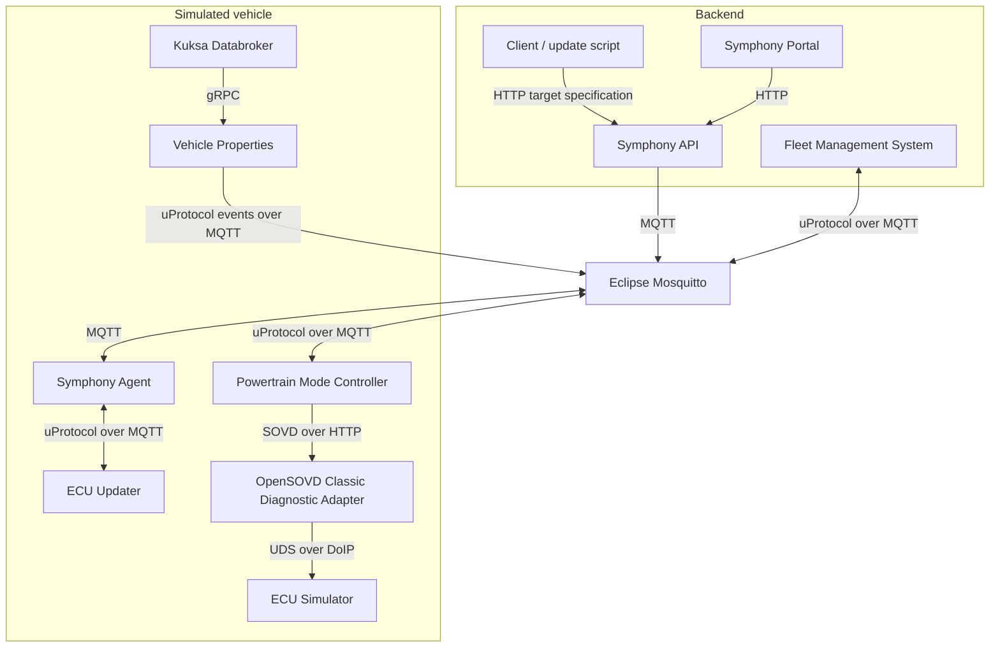

# Architecture

The [Docker Compose configuration](https://github.com/eclipse-sdv-blueprints/commercial-sdv-stack/blob/main/docker-compose.yaml) runs a fleet backend and a simulated vehicle on one host. Three Docker bridge networks separate backend communication, in-vehicle uProtocol services, and vehicle diagnostics.

## Component Map

The uProtocol arrows between services are logical connections carried by Mosquitto. No direct ECU Updater-to-CDA firmware deployment path is implemented.

## Services

| Compose service | Responsibility |
| --- | --- |
| `symphony-api` | Accepts deployment target specifications in the backend |
| `symphony-portal` | Provides a read-only view of Symphony targets and deployment progress |
| `mosquitto` | Carries Symphony messages and uProtocol communication using MQTT |
| `fms` | Represents the Fleet Management System; cycles powertrain modes and logs vehicle properties events |
| `symphony-agent` | Reconciles desired deployment state with the in-vehicle target provider |
| `ecu-updater` | Implements the Symphony target provider operations over uProtocol; stores firmware deployment state in memory |
| `databroker` | Hosts vehicle information using Eclipse Kuksa and VSS metadata |
| `vehicle-properties` | Makes vehicle properties available as uProtocol events |
| `powertrain-mode-controller` | Exposes uProtocol operations for reading and setting powertrain mode through SOVD |
| `sovd-cda` | Maps SOVD resources to UDS operations using preprocessed diagnostic definitions |
| `ecu-sim` | Simulates a DoIP-connected ECU, including powertrain mode read/write operations |
| `dozzle` | Displays container logs in a browser |

## Network Boundaries

| Network | Connected services |
| --- | --- |
| `backend` | Symphony API, Symphony Portal, Mosquitto, FMS |
| `vehicle-uprotocol` | Mosquitto, Symphony Agent, ECU Updater, Kuksa Databroker, Vehicle Properties, Powertrain Mode Controller |
| `vehicle-sovd` | Powertrain Mode Controller, CDA, ECU Simulator |

Dozzle is attached to Compose's default network and reads logs through the mounted Docker socket. These networks model logical boundaries; they are not a production vehicle security architecture.

## Diagnostic Definitions and Simulator

The repository contains the diagnostic model and its simulated counterpart:

- [config/cda](https://github.com/eclipse-sdv-blueprints/commercial-sdv-stack/tree/main/config/cda) supplies the preprocessed `blueprint-ecu.mdd` definition mounted into CDA.
- [odx](https://github.com/eclipse-sdv-blueprints/commercial-sdv-stack/tree/main/odx) contains Python scripts using [odxtools](https://github.com/mercedes-benz/odxtools) to generate example ODX data. OpenSOVD's [odx-converter](https://github.com/eclipse-opensovd/odx-converter) preprocesses diagnostic definitions for CDA.
- [ecu-sim](https://github.com/eclipse-sdv-blueprints/commercial-sdv-stack/tree/main/ecu-sim) contains the modified simulator based on the [doip-sim-ecu framework](https://github.com/doip-sim-ecu).

The model and simulator expose matching `PowerTrain_Mode_Read` and `PowerTrain_Mode_Write` operations. Regenerating diagnostic data is not required to run the supplied Compose demo.

## Follow the Message Flows

The [Firmware Update Walkthrough](firmware-update.md#message-flow) explains Symphony's target lifecycle. The [ECU Configuration Walkthrough](ecu-configuration.md#message-flow) follows a powertrain mode command all the way to the simulated ECU.