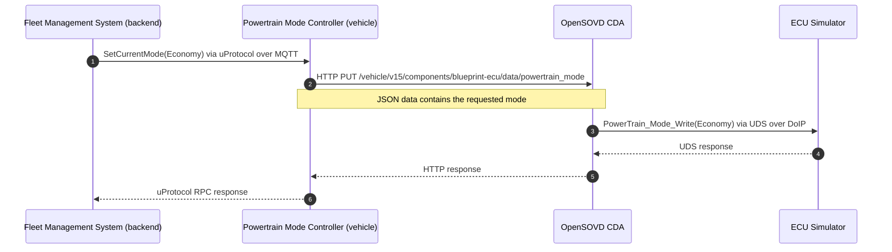

<!--
 Copyright (c) 2026 Contributors to the Eclipse Foundation

 See the NOTICE file(s) distributed with this work for additional
 information regarding copyright ownership.

 This program and the accompanying materials are made available under the
 terms of the Apache License Version 2.0 which is available at
 https://www.apache.org/licenses/LICENSE-2.0

 Assisted-by: GPT-6
 SPDX-License-Identifier: Apache-2.0
-->

# ECU Configuration Walkthrough

The Fleet Management System (FMS) changes the powertrain mode of the simulated vehicle by invoking the Powertrain Mode Controller over uProtocol. The controller writes an SOVD data resource, and the OpenSOVD Classic Diagnostic Adapter (CDA) translates it into a UDS operation on the ECU Simulator.

Unlike the firmware orchestration example, this path updates the simulated ECU's state.

## Before You Begin

Complete [Getting Started](getting-started.md). The `fms`, `powertrain-mode-controller`, `mosquitto`, `sovd-cda`, and `ecu-sim` services must be running. No separate trigger script is needed: FMS starts cycling modes automatically.

## 1. Follow the End-to-End Logs

From the repository root:

```bash
docker compose logs --follow --tail=100 fms powertrain-mode-controller sovd-cda ecu-sim
```

FMS attempts a mode change every five seconds after the preceding RPC completes. It cycles through `Performance`, `EvOnly`, `ForcedCharging`, and `Economy`, then repeats. Startup timing determines which mode you see first when opening the logs.

## 2. Identify Each Stage

### Fleet Management System

Look for a request such as:

```text
setting powertrain mode to Economy
```

This indicates the mode FMS is requesting over uProtocol, not proof that the ECU has accepted it.

### Powertrain Mode Controller

Look for the destination resource and mode:

```text
Setting current powertrain mode to SOVD server at http://sovd-cda:20002/vehicle/v15/components/blueprint-ecu/data/powertrain_mode
Successfully set powertrain mode to: Economy
```

The hostname `sovd-cda` resolves inside the Compose network. From your host, use `localhost:20002` instead. Always check the ECU Simulator logs as well: the current controller's success message alone is not sufficient evidence that an HTTP write was accepted by CDA.

### ECU Simulator

For example, the simulator may log:

```text
Set PowerTrain Mode: 2
Request for blueprint-ecu: '2E 4E 66 02' matched '{ PowerTrain_Mode_Write; Bytes: 2E 4E 66 [] }' -> Send response '6E 4E 66'
```

This shows a `PowerTrain_Mode_Write` request reaching the simulated ECU. Log formatting, timestamps, and the mode byte vary with the requested mode.

## 3. Verify Repeated Changes

Watch more than one cycle. Successful execution means that FMS requests different modes and corresponding `PowerTrain_Mode_Write` operations appear in the ECU Simulator logs. Use [API Exploration](api-exploration.md#read-the-current-powertrain-mode) to read the current diagnostic value independently.

Press Ctrl+C to stop following logs. The mode changes continue until you stop FMS or the stack.

## Message Flow



## Pause and Resume the Automatic Writer

Pause FMS before manually exploring configuration changes so it does not overwrite your experiment:

```bash
docker compose stop fms
```

Resume the automatic cycle afterward:

```bash
docker compose start fms
```

If requests appear in FMS but not in the ECU logs, follow [powertrain troubleshooting](troubleshooting.md#powertrain-modes-do-not-change).