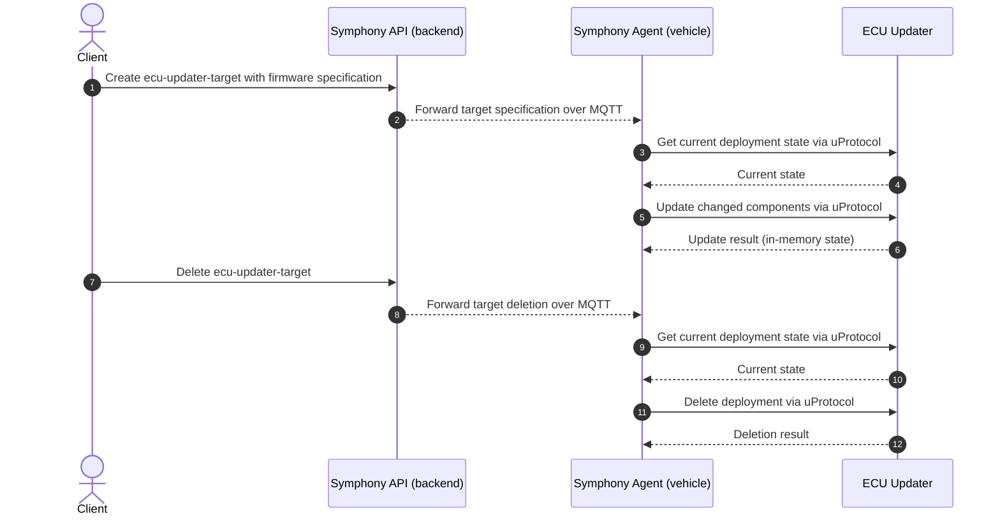

<!--
 Copyright (c) 2026 Contributors to the Eclipse Foundation

 See the NOTICE file(s) distributed with this work for additional
 information regarding copyright ownership.

 This program and the accompanying materials are made available under the
 terms of the Apache License Version 2.0 which is available at
 https://www.apache.org/licenses/LICENSE-2.0

 Assisted-by: GPT-6
 SPDX-License-Identifier: Apache-2.0
-->

# Firmware Update Walkthrough

This walkthrough demonstrates how a backend deployment request reaches an in-vehicle ECU Updater through Symphony and uProtocol.

**Simulation boundary:** the ECU Updater records deployment state in memory. It does not fetch the example URLs, flash an ECU, or call CDA. The logs demonstrate orchestration, not successful firmware installation on hardware.

## Before You Begin

Complete [Getting Started](getting-started.md) and verify Symphony is reachable. You need Bash, `curl`, and `jq`. Keep two terminals open at the repository root and optionally open the [Symphony Portal](http://localhost:3000).

The [target specification](https://github.com/eclipse-sdv-blueprints/commercial-sdv-stack/blob/main/scripts/target.json) describes the firmware components. The [trigger script](https://github.com/eclipse-sdv-blueprints/commercial-sdv-stack/blob/main/scripts/trigger_ecu_update.sh) authenticates to the local Symphony API as the demo `admin` user, creates `ecu-updater-target`, waits for Enter, and then deletes that target.

## 1. Watch the Vehicle-Side Logs

In the first terminal:

```bash
docker compose logs --follow --tail=50 symphony-agent ecu-updater
```

Leave this running while you trigger the deployment in the second terminal. Dozzle at http://localhost:8080 is an alternative log viewer.

## 2. Create the Deployment Target

In the second terminal:

```bash
bash scripts/trigger_ecu_update.sh
```

The script pauses at:

```text
Target registered. Press Enter to remove...
```

Do not press Enter yet. This prompt only means the script reached its waiting point; confirm the target and vehicle-side logs below to verify that registration and reconciliation succeeded.

## 3. Verify the Deployment State

In the Symphony Portal, log in with user `admin` and an empty password. Open **Targets** and look for `ecu-updater-target`.

In the ECU Updater logs, expect entries containing:

```text
installing firmware [name: Engine Controller, FW Image: "https://acme.io/fw/engine-control-1.45.img"]
installing firmware [name: Telematics Unit, FW Image: "https://non-existent.io/fw/telematics-unit-2.0.img"]
```

Timestamps and log prefixes vary. These URLs identify example firmware; they do not need to resolve because this updater does not download them.

## 4. Remove the Deployment Target

Return to the script terminal and press Enter. The script sends a DELETE request to Symphony. After reconciliation, the ECU Updater logs should contain:

```text
removing firmware [Engine Controller]
removing firmware [Telematics Unit]
```

The target should disappear from the Symphony Portal after a few seconds. Press Ctrl+C in the log terminal to stop following logs; the containers continue running.

You have completed the walkthrough when target creation and deletion are both visible in the portal and reflected in the ECU Updater logs.

## Message Flow



## Retry or Recover

If you interrupt the script before pressing Enter, the target may remain registered. Use the [interrupted firmware script recovery steps](troubleshooting.md#firmware-script-was-interrupted) before retrying. For a target with no vehicle-side activity, inspect the [Symphony and MQTT troubleshooting steps](troubleshooting.md#firmware-target-does-not-reach-the-ecu-updater).

Next, try the [ECU Configuration Walkthrough](ecu-configuration.md), which reaches the ECU Simulator through CDA and UDS.